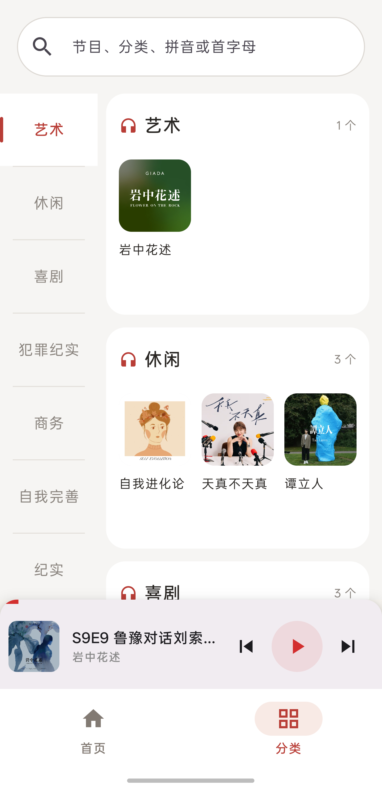
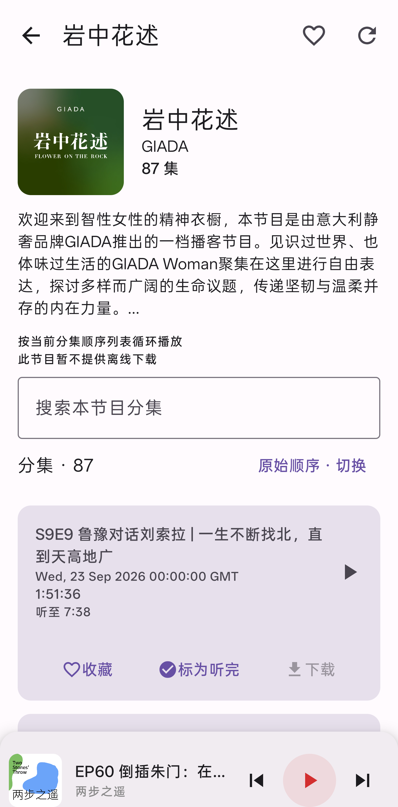
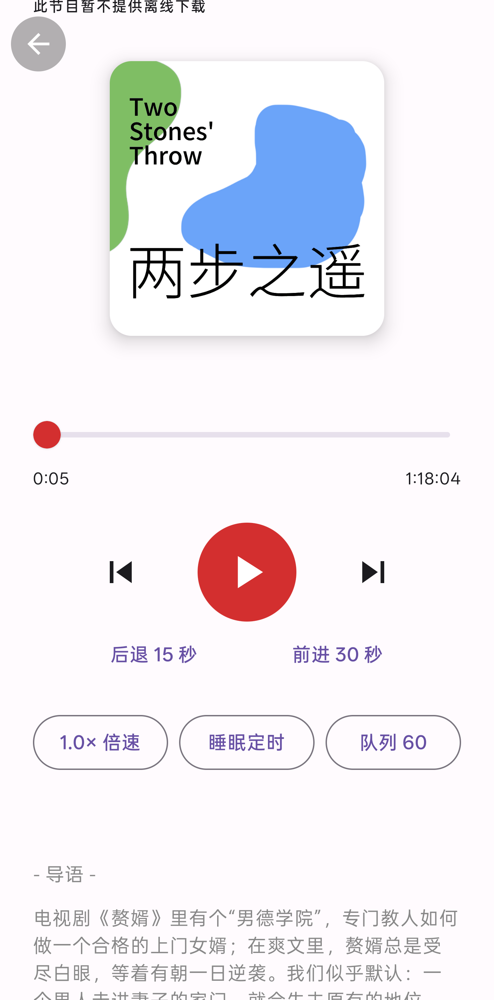
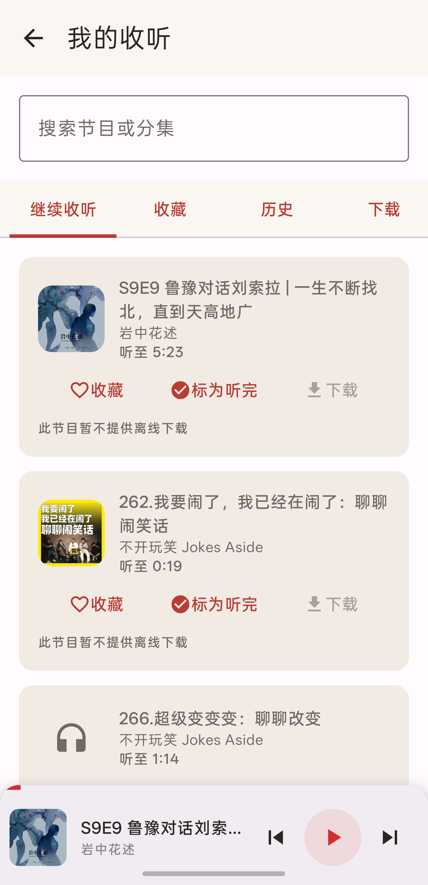
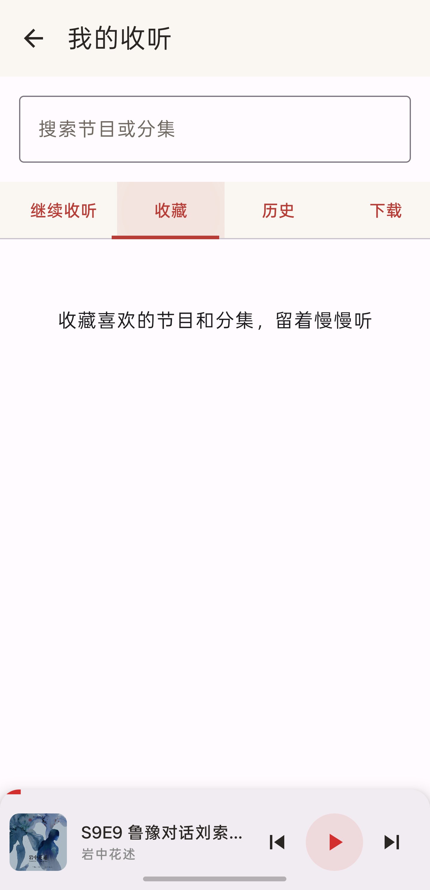
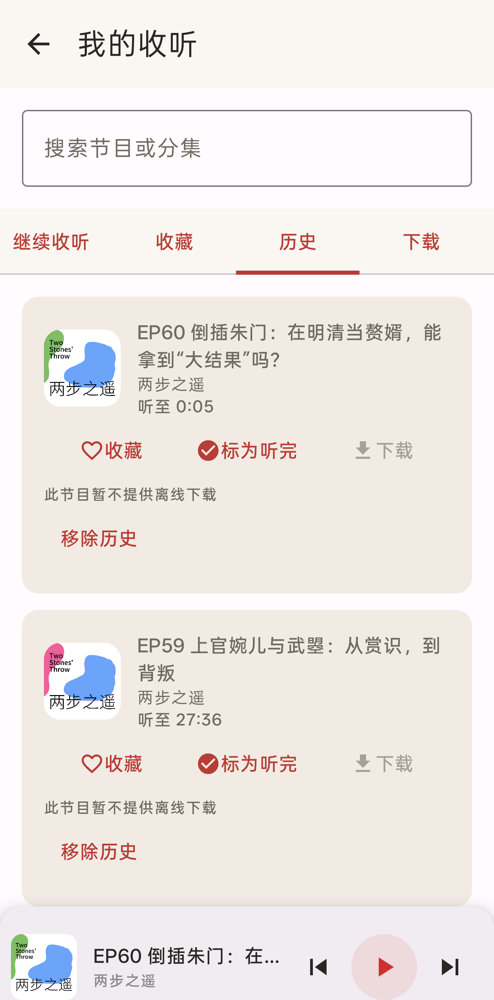
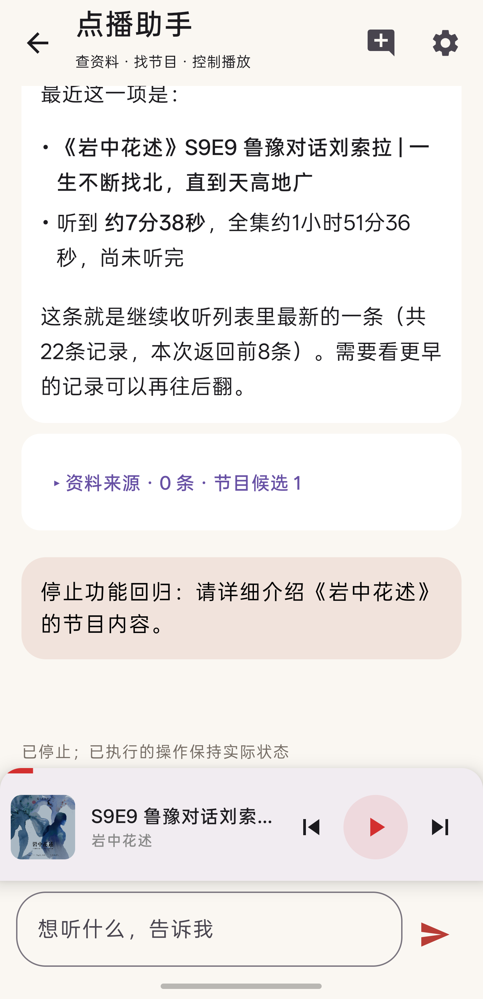
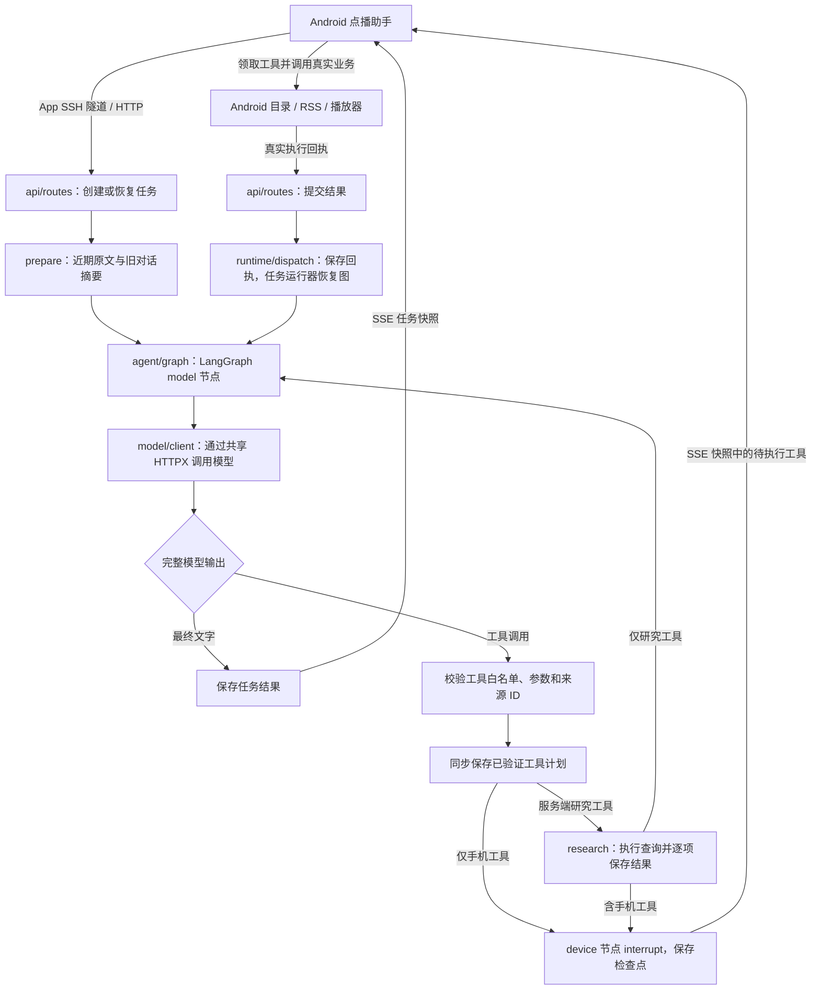

# MaoerLite · 猫耳

MaoerLite 是一款 Android 播客点播器，以公开 RSS 为内容入口，提供杂志风首页、分类浏览、中文与拼音搜索、收听资料库和大封面播放器。点播助手通过本机或内网 Python 服务理解请求，手机执行目录查询和播放控制，服务端执行 RSS 与网页资料查询。

版本：**1.1.0-dev**（versionCode 2）。内置 **30 个节目、19 个分类**，分集从 RSS 加载。iOS 保留工程入口和接口存根，播放能力尚未完成。

## 页面预览

以下八张页面图采集自当前 APK 的 Android 真机运行界面，均不包含系统状态栏。播放页展示控制区，点播助手展示真实播放器状态查询。

| 首页 | 分类 |
| --- | --- |
|  |  |

| 节目详情 | 播放页 |
| --- | --- |
|  |  |

| 继续收听 | 收藏 |
| --- | --- |
|  |  |

| 收听历史 | 点播助手 |
| --- | --- |
|  |  |

## 功能说明

### 发现与分类

- **首页**：暖色背景、红色点缀、大封面精选和节目列表；支持直接搜索节目。
- **分类**：左侧分类目录与右侧分组节目网格联动，支持分类内浏览和搜索。
- **导航**：只有“首页”和“分类”两个主入口。迷你播放栏单独占位，放在导航上方，并预留系统手势区域。
- **RSS 内容**：加载节目介绍、封面和分集信息，支持缓存及失败提示。元数据缓存用于再次浏览；音频离线文件由下载功能单独管理。 新打开节目页会先展示缓存再检查更新，右上角可手动刷新；助手查询分集也会请求 RSS。手机端没有新集推送；服务端为语义检索逐源维护 RSS 缓存和向量索引，约每小时继续更新。30 个内置节目名单固定，分集更新无需升级 APK。
- **结果定位**：修改搜索条件后，结果从顶部展示；点击分类目录定位到对应分组。首页与分类页分别保留浏览位置。

### 中文与拼音搜索

首页和分类页使用同一套本地搜索索引。输入时匹配内置节目的名称、分类及对应拼音，不需要向服务器提交搜索词。

| 想找的内容 | 可以输入 |
| --- | --- |
| 岩中花述：中文 | `岩中花述`、`花述` |
| 岩中花述：全拼 | `yanzhonghuashu`、`yan zhong hua shu` |
| 岩中花述：首字母或部分拼音 | `yzhs`、`huashu` |
| 科技分类下的节目 | `科技`、`keji`、`kj` |

搜索忽略英文字母大小写，兼容全角字母、数字，并对空格及标点做归一化处理。多个用空格分开的关键词也可分别匹配节目名称和分类。清空搜索词后恢复目录列表。

首页和分类页的空搜索框可显示灰色“猜你想搜”占位文字，来自当前对话相关的真实节目或分类；它不自动填入、不附加按钮，也不改变现有搜索范围。无对话、新建对话或关闭连接设置中的“根据当前对话推荐搜索”后恢复普通占位文字。旧版本对话尚未生成推荐时也不显示，后续新回复才会产生提示。

拼音索引覆盖当前固定的 30 个节目与 19 个分类；它不是任意中文全文转拼音服务。“我的收听”也可按节目拼音查找相关记录；RSS 动态分集标题按原文匹配，不承诺任意分集标题都可用拼音检索。

### 播放与队列

- 基于 **AndroidX Media3** 播放网络音频，支持后台播放、媒体通知及系统媒体控制。
- 进度条使用实际播放位置与媒体时长，可拖动定位；不使用演示时长。
- 节目页按当前分集筛选和排序生成队列，未筛选时包含整个节目的分集，不受列表分批展示数量限制。未开启睡眠定时时，队列第一集点“上一集”进入最后一集，最后一集点“下一集”回到第一集。
- 支持 **0.75×～2.0×** 倍速；睡眠定时提供预设时长、自定义时长及本集播完停止。
- 点击迷你播放栏的标题或封面进入播放页；播放页可收藏、标记听完，并查看分集简介。
- 应用重启后恢复队列与收听信息，保持暂停，避免自动出声。

### 我的收听

点击首页右上角的资料库图标进入“我的收听”。这是二级页面，不增加第三个底部主入口。

| 页面 | 用途 |
| --- | --- |
| 继续收听 | 找回未听完的分集，从各自保存的位置继续 |
| 收藏 | 管理节目收藏、分集收藏 |
| 历史 | 查看逐集收听记录，支持移除记录 |
| 下载 | 查看本地下载任务与文件；当前内置节目尚未开放下载 |

进度以分集为单位保存：切换节目或分集不会用新位置覆盖上一集的位置。自动切到下一集和手动切集均恢复目标分集未完成的进度；已完成分集从头重听，本集结束定时仍优先暂停。支持标记已听完。收藏、历史和进度保存在设备本地；当前没有账号登录、跨设备同步、用户订阅或自定义 RSS 导入。

### 下载能力与当前开放范围

Android 下载链路已接入系统 **DownloadManager**，实现任务状态展示、失败重试、取消、删除，以及已下载文件的本地播放。系统负责后台传输和网络条件调度。

**当前 30 个内置节目均未开放下载。** 来源核查中，两个声湃源已找到允许个人离线收听的附条件许可，但许可展示、来源链接、请求标识和缓存规则等接入条件尚待落实；其余 28 个源尚未确认具体适用的使用许可。音频下载链路已验证，来源接入条件尚待落实。

### 文字 点播助手

首页点击“点播助手”进入独立聊天页，服务连接统一在右上角设置。支持文字输入、流式回复、真实节目与分集卡片、停止生成、断线恢复及失败后重试当前步骤。页面切换不会主动取消任务；进程重启后可从本地记录恢复。输入框、播放栏与系统键盘分别占位。

右上角“新对话”会先删除服务端上一会话的任务记录（含消息、工具结果）和全部 LangGraph 检查点/中间写入，收到确认后再清空当前本地聊天记录、生成新对话 ID。删除失败或断线时保留当前记录并显示“重试删除”，重启也会继续确认删除，不重新创建旧请求。任务未结束时新对话按钮禁用。目前只保存当前会话供恢复，没有可切换的历史会话列表。

空对话的三条建议在本地从真实节目、真实分类及主题查询中各抽取一条，再打乱顺序；新建对话成功后排除上一组文案重新抽取，三条都换新。建议随对话持久化，返回页面或重启不重抽；旧版本记录首次加载时自动补齐。点击只填入文字，新建对话清空旧草稿。抽取不调用模型、不读取收听历史；真正的查询与推荐在用户发送后才执行。

服务端仅保留不含消息正文的已删除会话 ID 哈希，防止迟到的重试把旧会话重新创建出来。删除会话不撤销已发生的播放或定时操作。

**会话记忆与自动摘要：** 同一对话支持连续追问，例如“列出休闲节目”→“第二个叫什么”→“播放它的最新一期”。服务端最多携带最近 **20 轮已结束任务（包括完成、失败和取消）、80 条消息、48,000 个序列化 JSON 字符**，单轮记录本身超出预算时，先在模型输入中保留该轮用户问题、实际最终答复和工具状态，省略工具长正文，并把旧引用编号转为历史资料标记；原始任务记录不改写。随后统一按总预算保留或整轮移出，保持仍携带的工具调用与回执配对。失败或取消轮次保留用户要求和真实执行回执，并注明未完成状态；没有回执的操作记为结果未知，恢复时读取状态。普通短问答通常能保留 20 轮原文；包含多次工具调用或长 RSS 简介时会更早触发整理。这里按JSON字符计量；模型Token容量另行配置。Android 聊天页仍保留最近 30 轮可见记录，与模型输入预算分别管理。

意图识别与回答生成通过统一上下文入口使用同一批保留对话、已存摘要及真实引用身份，并记录保留轮次、摘要覆盖轮次和待整理轮次。各阶段按职责组织工具回执和资料，原始执行记录独立保存；播放器当前状态仍由实时查询提供。意图识别使用完整保留轮次中的问答内容，遵循上述会话预算。

移出的旧对话由当前配置的 **DeepSeek Flash（当前中转配置为 `deepseek-v4.1-flash`，关闭思考、不联网）**生成最多 **4,000 字符**的滚动摘要，保留明确偏好、主题、结论与未完成事项。不是每次聊天都额外调用模型，也没有使用 `SummarizationMiddleware`：LangGraph 的 `prepare` 节点在需要时整理，原子保存摘要及已覆盖任务 ID，再进入正常问答。已有摘要与新移出的交流合并，最新纠正优先；摘要请求不携带工具，不会执行播放操作。

对话显示支持 Markdown 表格、列表、强调和代码块；多列表格超出手机宽度时可横向滚动。“继续”等含糊表达由模型结合上下文判断和澄清，不使用固定回复、关键词拦截或专用工具禁用规则；这类意图识别仍有模型不确定性。标题期号优先识别 No./EP/Vol./第N期等标记，裸数字需有标题分隔，不把年份、年龄或数量前缀统计成期号。

RSS资料检索每页最多返回12个不同分集的相关说明，支持续页，并区分候选总数、本页展示数和本页未展示数。指定包含词或排除词时，在已存完整说明上逐条做字面检查，返回各词出现次数；截断说明不能作为排除后的候选。时长来自RSS的实际时长字段，支持按秒数上限筛选，未知时长不计入满足上限的候选，不从标题推算时长。追加推荐条件保留当前有效的节目、主题和偏好后重新查询；“轻松”等偏好按内容含义判断，明确要求包含某词时才做字面筛选。短说明可直接完整返回，较长说明按4000字符分页读取。字面筛选统计指定词在RSS说明中的出现情况；当前不支持音频内容检索。节目简介最多2400字符。RSS说明与网页正文按文字资料引用。助手的手动操作说明以当前App能力为准，没有收藏排序选择器或静默选集入口。

每次用户请求最多整理两批，每批最多 8 轮、24,000 个资料 JSON 字符、45 秒；超长单轮提取用户要求、最多 3,000 字符的最终回复及工具成功/失败记录，并标记截断。摘要保留关键信息，较早对话的逐字原文会从模型输入移出。生成失败、限流或结构校验不通过时保留上次成功版本，不推进覆盖记录；聊天页提示“部分较早对话尚未整理”，后续请求再补齐。普通回复继续使用近期原文与已有摘要，缺失关键要求时应澄清。摘要调用也计入共享限流，会增加少量延迟与 Token 消耗；它不占用手机工具的 36 次预算。

**真实候选引用独立保存：** 最多 4 组真实候选及最近确认播放过的对象，总计不超过 8,000 个 JSON 字符，引用超过 6 轮后过期。保留节目/分集 ID、名称、原始顺序及来源任务/工具 ID；摘要中的 ID 和仅出现在过期聊天里的 ID 都不能授权播放。用户说“第二个”时依据仍在上下文中的助手展示列表，不能靠摘要猜顺序；歧义时澄清。当前播放、倍速、定时仍查询手机，“最新一期”重新查询 RSS。新建对话同时删除旧任务、摘要、引用及检查点；不保存跨会话偏好。公共RSS内容另存SQLite向量缓存，不把用户对话放入该语料库。

| 可以怎么说 | 手机执行的能力 |
| --- | --- |
| 帮我找岩中花述 / 找几个科技节目 | 复用中文、全拼和首字母目录索引，返回真实节目卡片 |
| 播放岩中花述最新一期 | 查询 RSS、核对分集 ID 和发布日期后，调用现有播放器 |
| 现在播放的是什么？ | 读取实际播放分集、播放状态和定时状态 |
| 暂停 / 继续播放 | 调用现有播放控制，并返回实际状态 |
| 上一集 / 下一集 | 在当前完整队列中切换并播放，第一集与最后一集首尾循环；没有队列时提示先选择节目 |
| 调成 1.5 倍速 / 现在几倍速？ | 设置或查询播放器实际倍速，支持 0.75、1、1.25、1.5、1.75、2 倍；调速保持原有播放或暂停状态 |
| 20 分钟后停止 / 本集播完停止 / 取消定时 | 复用现有睡眠定时规则 |

工具注册表共17种：12种手机工具（含资料库只读查询）和5种服务端资料工具（网页搜索、网页正文读取、RSS语义检索、分集说明分页读取及跨节目最近发布）。客户端只收到实际支持的手机工具。目录、个人资料库和播放工具按当前意图开放；网页只读查证按联网许可及客户端能力开放，分类漏判不会关闭查证能力。普通知识问题不因此检索播客。手机执行目录与播放操作，服务端资料工具由服务端执行。工具只接受约定参数；播放地址从现有目录/RSS 获得。分集日期无法可靠解析时会标记“最新顺序未确认”，不把 RSS 第一项直接当作最新一期。播放操作保留完整节目队列，并区分已开始、正在加载与失败。

助手业务统一使用“模型调用工具 → 工具实际执行 → 结果返回模型 → 模型回答或继续调用工具”的循环。系统提示词由共用核心和按任务加载的查询、介绍、播放、资料库等模块组成；普通事实问答、分集介绍与应用任务使用统一组装入口，状态和配置按事实数据提供。程序从真实回执中完成资料库筛选、列表计数、顺序和时长处理，将计算结果交给模型组织答复；播放操作也把实际回执返回模型后回答。普通问答直接生成文本，资料介绍和记忆回顾使用共享对话上下文及实际资料生成正文，不再额外生成通用正文结构和逐来源自证表。

网页搜索每次最多返回8个候选。实时外部信息查询优先核对官网近期公告、发布记录或官方文档，按事件或发布日期判断时效。事实问答读取候选正文，只列搜索结果或摘要时将搜索结果返回模型组织答复。事实回答的引用绑定到实际读取的正文，未读候选保留为后续查证入口；原始搜索摘要与回执独立保存。来源编号检查本轮实际资料；明确请求原文时，由模型选择真实原文片段，程序保留原句和出处。来源编号支持连续显示与逐个点击，点击后展开并定位到对应资料；滚离回答开头后可直接跳回。

播放器状态来自实际查询，模型可按任务需要再次读取；每次新调用分别保存回执，恢复和重复提交按调用ID去重。状态观察只说明读取时的情况，最终答复使用最新一次观察；最新查询失败时直接说明失败。缺少任务所需的查询前提时，运行时把缺项交给模型，由模型发出工具调用，继续使用统一工具预算。

混合请求保存各项用户目标及明确的先后依赖，分别记录操作回执、查询资料和交付进度。“先暂停、查证、最后继续”在查证目标结束后才开放继续播放；“顺便暂停”等独立控制优先执行。查询次数由实际信息需要和统一预算决定；只给搜索结果时不读取正文，不支持的倍速不会替换成邻近档位。运行时保留必要的资料读取、身份与参数、分页完整性及取消恢复检查。每个阶段由模型回答，已经交付的正文和实际操作结果独立保存；后续生成失败时展示已有正文及执行事实，重试从未完成步骤继续。

节目明确但未指定分集时，助手先查询真实候选，再问一次要播放哪一期；用户接着选择“最新一期”“刚才第二个”或具体标题后继续执行，不默认替用户选集。介绍、推荐、列举和能力询问本身不授权播放。

新版分集查询每页最多 8 条，支持分页、RSS 原始顺序、倒序和按发布日期从新到旧，也可明确指定完整列表位置。“第一集”取原始RSS最后一条，“第N集”取倒数第N条；例如原始列表按250到1排列，第一集取末尾的1。此规则不依赖发布日期，不把末条冒充已核实的最早发布内容。找到后展示真实标题并先确认一次，确认后播放；越界或查询失败时说明原因，不自动改查标题期号。明确“第N期/标题期号N”按作者编号查询，“原始列表第N条”从列表开头数；当前页面排序未提供时先澄清。只有用户明确按发布时间定位时才要求日期完整。

新客户端创建任务时声明 `episode_selection_v2` 能力。旧客户端仍使用原有标题查询参数，服务端不会向它派发新参数。新客户端遇到旧服务端在创建任务前明确返回 `400 invalid_request` 时，仅移除能力声明、沿用原任务 ID 协商一次旧协议；不重试超时、认证或模型错误。完整的新分集能力仍需更新服务端，推荐先部署兼容服务端，再更新 APK。

跨轮候选播放还有服务端执行前校验：当前请求尚未成功查询该节目的分集时，先用只读工具刷新 RSS，再让模型重新选择并完成剩余操作，不直接派发旧控制计划。查询失败时不开始新的播放；这一步计入原有工具预算并沿用持久化回执，避免仅靠提示词要求刷新。按旧列表选择时保留原展示顺序，不因补查列表而重新编号。

推荐数量不足时先说明，扩大类别需用户同意；每个正式推荐候选核对节目简介。复合请求按子任务处理，例如超范围定时不阻塞独立的暂停操作。助手仍不执行下载、收藏或标记已听完；手动下载是否开放取决于当前来源条件，不能无条件承诺节目页有下载入口。

模型可以一次请求多个工具，例如分别查询科技、历史、艺术。服务端先校验整批工具、参数和调用 ID，再逐个派发给手机；每项回执持久化后才派发下一项。整批结束后，全部结果与原始调用一起返回模型。客户端显示当前批次进度。搜索→查询分集→播放等依赖真实 ID 的步骤必须分轮生成，不允许猜测同批尚未返回的 ID。

独立查询失败可以继续其他查询；控制操作返回失败、未知或尚未确认时，本条任务停止后续控制操作，保留查询能力并明确标记未执行。重启根据已保存的逐项结果继续，重复回执不再次执行；取消停止后续派发，已领取操作迟到的实际回执仍可保存。

每个任务、工具调用都有独立 ID。手机在执行前写入标记，完成后保存回执；重复请求返回已有结果。若应用中断导致操作结果不确定，会回传当前状态及“不确定”，不会自动再播一遍。停止生成会阻止后续操作，已经开始的播放不会因此自动暂停。

进程重启后补交已保存的播放回执时，原执行结果和去重指纹保持不变，另行标记回执来自重启前。服务端补查一次真实播放器状态，再报告当前播放或暂停状态；已完成的切集不重复执行，也不因恢复后暂停而自行继续播放。原请求中尚未完成的倍速、定时等操作继续按原要求处理。

### RSS 资料检索与联网来源

助手先结合当前问题和必要对话上下文判断播客、网页、播放控制意图，再向回答模型提供对应工具。最新外部信息使用 Tavily 基础搜索并读取关键网页核实；一般知识无需检索播客。意图判断仍由模型完成，项目执行工具范围约束，分类失败会如实报错。

RSS使用完整分集说明建立重叠片段，结合关键词与本地免费 BGE 中文向量召回候选，再由现有生成模型核对直接支持证据；相关片段按分集去重后分页，每页最多12个不同分集。`offset`从0开始，`has_more=true`时用返回的`next_offset`继续读取，保持查询、节目范围及包含/排除条件一致；追加或改变筛选条件后从0重新查询。推荐3集时从候选中选3集，要求列出全部时继续读取剩余页。`matched_episodes`统计本次候选集中通过直接相关性核对的分集数，`returned`为本页数量，`omitted`为本页未展示的数量（包含此前页），续页结束以`has_more`为准。正式推荐按实际内容选择并计数。`semantic_indexed_passages / total_passages`按片段统计向量覆盖，重复窗口分别计数；`semantic_unique_vectors`单独报告复用后的唯一向量键数，`semantic_query_available`报告本次查询向量是否可用。

模型输入中的单条工具结果最多64,000字符，消息契约与上下文校验使用同一上限。RSS检索在每页20,000字符的说明证据预算内，按实际返回条数分配连续原文窗口，单条最多4000字符；能放下的说明完整返回，长文保留真实偏移和截断标志，可继续读取。模型消息契约中的非工具消息仍最多16,000字符，工具参数字符串仍最多16,000字符。App创建任务时的提问仍最多2000字符。整体上下文预算及每批最多12项、整轮最多36次工具调用保持独立。其他工具的单页数量保持各自约定。

服务端最多同时请求3个源、单源等待15秒；每源最多1000个可播放分集，XML最大8MB、单集说明最多262144字符。说明过长明确标记截断，按需每页读取4000字符。索引后台增量建立，结果报告实际已索引片段数量；未建好部分只按关键词检索，失败可使用带原读取时间的缓存。查询结果注明实际覆盖的来源及命中的说明。

每条回答下方的资料区默认折叠。正文使用[1]、[2]等编号，点击可展开并定位来源；同一来源的搜索摘要、正文与分页保持同一编号。区分回答引用、其他检索资料、RSS说明、网页搜索摘要与正文节选，显示可用的发布时间和读取时间。可阅读保存的原文，或打开原网页；RSS没有分集网页链接时打开RSS来源。播放前刷新等内部候选不再直接铺满聊天。

Tavily密钥仅保存在服务端私密配置，部署须使用免费账户并关闭按量付费。每月应用内最多950次信用预留，基础搜索与单页基础提取均保守预留1次，失败或结果不确定不退回，重复请求不再次调用。额度接口最多每10分钟在后台查询一次，其429、超时或异常不阻止正常搜索；成功取得的免费余额仍按预留扣减，已确认余额不足或付费配置会停止调用。实际搜索/提取的429按服务方等待时间持久化冷却，432/433停止本月调用，不自动升级或转付费。仅允许basic模式并关闭自动参数升级；账户在项目外启用付费或共享密钥的消费不受本地账本控制，免费账户的服务商硬上限仍是必要条件。分页复用已取得正文，网页正文最多保存20万字符，受动态加载与站点限制影响，不承诺覆盖网页全部内容。

音频转写、ASR/TTS、收藏和下载控制尚未支持。目录搜索仍匹配节目名、分类、中文及拼音；RSS语义能力仅用于助手资料查询。播放前手机刷新、真实身份核对、选集确认、工具去重与原队列规则保持。节目目录统计仍由既有查询工具提供，不使用语义检索命中数量代替RSS总量。

向量模型为 [BAAI/bge-small-zh-v1.5](https://huggingface.co/BAAI/bge-small-zh-v1.5)（MIT），通过 fastembed 0.7.4 在CPU运行。目录清单位于`agent-server/maoer_agent/resources/research_catalog.json`，修改内置节目时须与Android目录、分类和拼音表同步。用户新建对话删除会话任务、来源关联和搜索提示，公共RSS缓存不作为个人记忆。

### 最近发布与个人记录查询

助手支持跨节目最近发布查询：按RSS发布日期排序，默认每档取最新一期再列出最近的节目，也可查询合并后的分集列表、指定天数或节目范围。单页最多8项，明确总数和后续分页。工具复用现有RSS加载和缓存，不走语义相关度排序；最多并发3个RSS请求，单次刷新等待上限25秒，未完成或失败时如实返回缓存范围。返回刷新覆盖数、缺失/异常/无时区及未来日期计数；发布时间与刷新时间分开，北京时间由程序转换后提供给模型。当前按发布日期查询；尚不支持统计“上次访问后新增”的内容。

个人资料库查询用于回答“上次听到哪里”“收藏了哪些节目”“以前听过哪一期”“已经下载了什么”。助手按问题查询继续收听、收藏、历史或下载记录，支持分页及节目中文/拼音搜索；每次只读取涉及的页签。查询复用资料库页面筛选规则，按条目类型返回信息：收藏节目包含节目身份、名称和分类；继续收听、历史与收藏分集包含分集及所属节目信息、收听位置、总时长、最近播放时间、已听完和收藏状态；下载分集包含分集及所属节目信息、下载状态、字节数和离线可用性。当前不支持累计实际听时、收藏时间统计，也不支持通过助手添加收藏、标记已听完、发起或删除下载。旧版客户端不支持个人资料库查询。跨节目RSS最近更新使用独立的日期查询接口。

模型通过资料库工具取得记录，程序依据实际分页数据计算筛选结果和收藏计数，再交给模型回答，保留页内顺序、原始位置与收听进度；最后一页查询只展示对应页。复杂筛选、比较和混合操作继续在同一Agent循环中处理。分集说明连同标题、时长和引用作为模型的回答资料。手动界面操作说明按当前问题提供；内容回答保留完整说明节选、引用和分页信息，检索工程统计在用户询问相应统计或技术含义时提供给回答模型。原始工具结果独立保留。

### 独立分集网页

单独请求某集独立网页链接时，助手先检查已取得的分集资料；手机回执没有原网页字段时，模型调用工具读取该集RSS说明。已有链接交给模型回答，缺少链接时继续调用搜索与网页读取工具，核对节目与分集身份后提供链接。搜索没有结果、读取失败或免费额度用完时，模型根据实际回执说明查询结果。用户明确禁止联网时只使用现有资料；出现同名分集时先列出候选供选择。

路由区分分集独立网页、节目主页、资料原句和目录分集定位。节目主页按节目身份核对；追问支持原文时读取已取得的资料或对应RSS说明；目录定位沿用列表位置及标题期号规则。单独的链接查询按结构化目标推进，一次最多搜索一轮、核对三个候选页面；包含其他任务的复合请求由通用 Agent 处理。工具调用继续计入统一预算并保存逐项回执。

## 技术组成

| 层次 | 实现 |
| --- | --- |
| 共享业务与界面 | Kotlin 2.0.0、Compose Multiplatform 1.6.11、Coroutines |
| 页面导航与依赖注入 | Voyager 1.0.0、Koin 3.5.6 |
| 网络与 RSS | Ktor 2.3.12、xmlutil 0.86.3 |
| 图片加载 | Coil 3.0.4 |
| Android 播放 | Media3 1.4.0、MediaLibraryService、MediaController |
| SSH 连接 | mwiede/JSch 2.28.6、主机指纹校验、Android Keystore AES-GCM |
| 本地保存 | DataStore 1.1.1、Okio 3.9.1、逐条 JSON 文件持久化 |
| Android 下载 | 系统 DownloadManager |
| Android Agent | Ktor SSE、协程/StateFlow、应用私有执行回执 |
| Python Agent 服务 | FastAPI、HTTPX、LangGraph 1.2.11、SQLite 检查点 |
| Agent 基础组件 | langchain-core 1.6.3；未引入完整 LangChain Agent |
| 构建 | Gradle Wrapper 8.14.3、Android Gradle Plugin 8.5.2 |

共享层负责目录、RSS 解析、搜索、队列规则和收听资料；Android 层负责播放器、媒体服务与下载系统的接入。

```text
composeApp/src/
├── commonMain/kotlin/com/maoer/lite/
│   ├── data/podcast/       # 内置目录、RSS、缓存与拼音索引
│   ├── data/library/       # 收藏、历史、逐集进度与持久化
│   ├── data/manager/       # 播放状态、队列、定时规则与 PlaybackSnapshotStore 快照存储
│   ├── data/download/      # 下载模型与接口
│   ├── data/agent/
│   │   ├── AgentApi.kt        # 任务HTTP/SSE协议及只读连接获取
│   │   ├── AgentModels.kt     # 会话/工具协议、批次进度与摘要状态
│   │   ├── AgentSession.kt    # 界面使用的对话门面
│   │   ├── AgentConversationController.kt # 应用级操作、发送/取消/新建与状态
│   │   ├── AgentRunFollower.kt # 在当前操作作用域内跟随SSE、执行工具和回传
│   │   ├── AgentConversationRecords.kt # 会话历史与待同步意图的持久化入口
│   │   ├── AgentUiState.kt / AgentPresentation.kt # 会话状态与页面展示映射
│   │   ├── AgentSuggestions.kt # 真实目录驱动的每会话随机建议
│   │   ├── AgentTools.kt      # 会话调用工具的统一入口，组装执行器与处理器
│   │   ├── AgentToolExecutor.kt # 领取、执行标记、去重、取消及未提交回执恢复
│   │   ├── AgentToolResult.kt  # 工具失败结果的共同格式
│   │   ├── CatalogToolHandler.kt # 目录搜索、分集与 RSS 资料工具适配
│   │   ├── PlaybackToolHandler.kt # 播放控制、倍速、定时与执行状态确认
│   │   ├── PlaybackStateReader.kt # 当前选中分集、节目身份与播放器状态投影
│   │   ├── AgentConnectionManager.kt # 连接核验、旧任务归属检查及配置保存
│   │   ├── AgentEpisodes.kt   # 分集分页、标题期号与列表位置选择及排序校验
│   │   ├── AgentCatalogSummary.kt # 完整可用目录的编号、缺口与解析数量核查
│   │   ├── PodcastKnowledge.kt # RSS节目简介、目录统计与原文证据
│   │   ├── AgentStorage.kt    # 连接、聊天及工具执行回执存储接口
│   │   └── AgentTransport.kt  # HTTP/SSH连接与平台安全存储接口
│   ├── ui/                 # 首页、分类、节目、播放、资料库和 agent 聊天页
│   │   └── components/PlaybackComponents.kt # 共用播放栏及节目封面，保留原布局
│   └── di/                 # 共享依赖配置
├── androidMain/
│   ├── AndroidManifest.xml # 应用入口、网络及前台播放权限、服务声明
│   ├── kotlin/com/maoer/lite/
│   │   ├── MainActivity.kt                   # Android Activity，承载共享 Compose 界面
│   │   ├── MaoerApplication.kt               # Application 初始化与 Koin 启动
│   │   ├── Platform.android.kt               # Android 平台信息实现
│   │   ├── data/
│   │   │   ├── agent/
│   │   │   │   ├── AgentStorage.android.kt  # noBackupFilesDir 存储路径与发布日期解析
│   │   │   │   ├── AgentTransport.android.kt # SSH 隧道与主机指纹
│   │   │   │   └── AgentCredentials.android.kt # Android Keystore 凭据加解密
│   │   │   ├── manager/
│   │   │   │   ├── AndroidMediaPlayerController.kt # 连接媒体服务、控制播放、同步状态
│   │   │   │   └── MediaItemMapper.kt         # 队列/单项媒体构造及 Audio 反向映射
│   │   │   ├── download/
│   │   │   │   └── AndroidDownloads.kt       # 系统下载任务、状态恢复与本地文件
│   │   │   └── local/
│   │   │       └── DataStoreConfig.android.kt # 应用私有目录中的 DataStore 路径
│   │   ├── service/
│   │   │   ├── MaoerPlaybackService.kt       # ExoPlayer、媒体会话、后台播放与进度保存
│   │   │   └── PlaybackCommands.kt           # 睡眠定时命令与会话状态字段
│   │   └── di/
│   │       └── PlatformModule.android.kt    # 注入 Android 播放器和下载实现
│   └── res/                                 # Android 启动图标、应用名称等资源
└── iosMain/                # iOS 工程入口与平台接口存根
gradle/libs.versions.toml   # 依赖版本
iosApp/                    # iOS 宿主工程
agent-server/              # 一个 Python 服务进程，按职责组织为包
├── main.py                # 兼容现有部署命令的薄启动入口
├── chat.py                # 兼容现有终端聊天命令的薄入口
├── start.ps1 / start.sh    # Windows / Linux 用户目录进程管理
├── requirements.txt       # 运行依赖版本锁定
└── maoer_agent/
    ├── __main__.py / cli.py # 服务启动与终端客户端实现
    ├── api/                # 入站请求、任务路由及显式公开响应
    │   └── app.py / routes.py / protocol.py / responses.py / transport.py
    ├── application/        # 依赖装配、来源查询及固定结果呈现
    │   └── bootstrap.py / sources.py / replies.py
    ├── contracts/          # 中立的消息、工具、意图、执行上下文与错误契约
    ├── agent/              # LangGraph执行与任务生命周期
    │   └── graph.py / tasks.py / state.py
    ├── runtime/dispatch.py # 设备批次、领取、回执与推进决定
    ├── workflows/          # 意图路由、工具范围、选集与独立网页流程
    │   └── intent.py / planning.py / selection.py / episode_pages.py
    ├── context/            # 模型输入组装、提示、引用视图与输入预算
    │   └── assembler.py / prompts.py / route.py / budget.py
    ├── memory/             # 近期对话、候选引用及滚动摘要
    │   └── history.py / summary.py
    ├── model/              # 生成/向量适配、准入与上游通信
    │   ├── client.py / provider.py / embeddings.py / gate.py
    │   └── rate_limit.py / transport.py / failures.py
    ├── tools/              # 工具定义与实际回执校验
    │   └── definitions.py / results.py
    ├── research/           # RSS、网页、证据及公共资料存储
    │   └── rss.py / updates.py / sources.py / store.py / tools.py / web.py
    ├── storage/tasks.py    # 任务、摘要和删除标记持久化
    ├── core/
    │   └── config.py / errors.py / limits.py # 配置、文案与调用上限
    └── resources/
        └── error_catalog.json / research_catalog.json
```

项目保留一个 `composeApp` Gradle 模块和一个 Python 服务进程。任务 API、工具协议、SQLite 表、LangGraph 检查点、播放快照键与凭据加密格式保持兼容。Android 的 `AgentTools` 组装业务处理器与 `AgentToolExecutor`，后者统一维护“领取 → 保存执行标记 → 操作 → 保存结果”的顺序；会话取消补传与新建删除流程继续复用这一机制。

### Android 层如何协作

| 组件 | 具体职责 |
| --- | --- |
| `MainActivity` / `MaoerApplication` | 启动 Android 应用，初始化依赖注入，并把共享 Compose 页面挂载到 Activity。 |
| `AndroidMediaPlayerController` | 实现共享层的播放器接口，通过 MediaController 连接后台服务；发送播放、暂停、定位、倍速和定时命令，将播放状态与实际进度反馈给界面。 |
| `MaoerPlaybackService` | 继承 MediaLibraryService，持有 ExoPlayer 和媒体会话；处理后台播放、系统媒体控制、队列切换和睡眠定时，并保存收听进度及播放快照。 |
| `PlaybackCommands` | 统一控制器与服务之间的自定义命令和字段，包括定时分钟数、剩余时间及本集结束停止状态。 |
| `AndroidDownloads` | 把共享下载接口接到系统 DownloadManager，管理任务入队、状态查询、重试、取消、删除及任务恢复，并提供可播放的本地文件。 |
| `DataStoreConfig.android` | 提供应用私有 `filesDir` 下的 DataStore 文件路径。收藏、历史等逐条 JSON 持久化逻辑位于共享层 `data/library`。 |
| `PlatformModule.android` | 通过 Koin 将共享的 `MediaPlayerController`、`Downloads` 接口绑定到 Android 实现。 |

播放命令从共享页面经过 `PlayerManager` 和 `AndroidMediaPlayerController` 到达后台媒体服务，播放状态再回传到界面。下载传输由系统 DownloadManager 执行，下载模块提供状态和文件供资料库、播放器使用。

### Python 服务端如何协作

服务端分为模型网关和 Agent 任务管理两部分，共用 HTTPX 连接、并发限制与冷却状态。业务实现位于 `agent-server/maoer_agent/`，按接口、任务、模型、工具、资料和存储职责分目录；Android 通过任务接口使用 Agent，`chat.py` 则通过原始聊天网关提供终端文字交流。

| 模块 | 具体职责与边界 |
| --- | --- |
| `main.py` / `core/config.py` | 读取服务端配置并启动Uvicorn；供应商密钥和客户端访问令牌保存在服务端。 |
| `contracts/` | 消息、工具、意图、研究执行上下文及共享错误契约；不依赖API或具体任务流程。公共聊天请求与内部Agent请求各自保留字段限制。 |
| `api/app.py` / `protocol.py` / `transport.py` | 公共聊天网关、入站校验、调用方断连和公开响应过滤；供应商请求转换与HTTP调用交给模型适配器。 |
| `api/routes.py` / `responses.py` | 任务创建、查询、取消、重试、会话删除、领取及回执接口；HTTP与SSE共用显式字段投影，保留字段缺失含义，不自动公开新内部字段。 |
| `application/bootstrap.py` | 创建HTTP之外的模型、知识、存储与任务依赖，管理后台索引、任务恢复和关闭顺序。任务服务接收已创建依赖。 |
| `application/sources.py` / `replies.py` | 根据任务绑定的来源编号查询已保存正文或节选；固定网页查询结果的链接、文字和引用呈现。查看保存的正文不触发新的联网查询。 |
| `agent/tasks.py` / `graph.py` / `state.py` | 任务生命周期、有限重试与调用预算；保留prepare/model/research/device节点和检查点字段。图调用上下文、流程和工具服务，设备执行等待真实回执。 |
| `runtime/dispatch.py` | 单批最多12项，逐项派发、保存领取和回执、去重及批次推进；返回恢复决定，由任务运行器统一启动LangGraph恢复。取消后迟到回执可保存但不继续派发。 |
| `workflows/` | 意图分类与工具范围、真实身份与选集确认、播放前刷新、独立分集网页的检查/搜索/读取/身份核对。返回流程决定，不持有播放器或创建知识存储。 |
| `context/assembler.py` / `budget.py` | 统一组装主回答与引用修正输入，结合记忆、摘要、本轮证据、实际工具与预算；只处理输入副本，不写任务、执行工具或联网。 |
| `context/prompts.py` / `route.py` | 基础提示、能力说明及当前意图的模型输入表达，与工具定义和执行策略分离。 |
| `memory/history.py` / `summary.py` | 近期完整交流、带来源的候选引用和滚动摘要；保留失败/取消轮真实结果，摘要不作为可执行ID或实时播放器状态。 |
| `model/client.py` / `provider.py` | 公共网关与Agent共享供应商请求转换、出站HTTP和上游错误分类；Agent保留流式文字、完整工具参数及内部推理续传。 |
| `model/embeddings.py` | 本地BGE加载、并发及文档/查询向量生成，向知识层提供向量接口和索引身份；RSS层决定切块、筛选、排序和缓存。 |
| `model/transport.py` / `gate.py` / `rate_limit.py` | 有界上游读取与SSE解析、并发准入、429及Retry-After共享冷却；任务节点据此安排有限重试。 |
| `tools/definitions.py` / `results.py` | 12项手机工具和5项服务端工具的参数、位置、能力与结果规范；校验实际观察，原始回执及指纹独立保留。 |
| `research/` | RSS解析、语义/词法检索、按日期查询、正文和来源管理；研究工具接收明确请求身份与来源快照。网页接入继续管理免费额度、去重、冷却和用量。 |
| `storage/tasks.py` | 保存任务、摘要与删除标记，沿用任务库与独立检查点库；对外字段由API协议层决定。 |
| `core/` / `resources/` | 根目录配置定位、错误文案、调用上限、URL分类及固定目录资源；Android共享同一错误目录。 |
| `start.ps1` / `start.sh` | 用户目录下的进程管理；Linux复用已有Python/Conda及进程锁。 |

一次“播放岩中花述最新一期”的请求，会按下面的路径查询真实节目和分集，再控制手机播放器：



LangGraph 每轮可接收最多 12 个工具，服务端每次向手机派发一个；搜索节目、查询分集和开始播放可以跨多轮完成。`device` 节点等待手机回执时保存检查点，收到结果后把它加入工具消息并恢复 `model` 节点。模型回复中的“已播放”必须有手机执行结果支撑，服务端本身不持有播放器。

研究工具在独立的 `research` 节点执行，执行前同步保存工具计划，逐项保存已开始标记和实际结果。恢复同一计划时复用已保存结果；若查询已开始但结果未落盘，会如实返回“结果不确定”，不自动重发可能消耗额度的请求。混合请求按用户目标依赖开放工具；同批相互独立的手机操作先执行，再完成服务端研究，并保持模型工具调用与回执的配对。需要前一步结果作为参数的调用分轮进行。

系统提示按本次实际提供的工具组装，避免新旧能力说明互相矛盾。收尾核对对照用户要求，列出工具结果和未完成项；模型据此给出简洁回答。

任务持久化使用两个独立 SQLite 文件，研究资料另有独立数据库，默认位于仓库根目录的 `.local/`：

| 运行文件 | 保存内容 |
| --- | --- |
| `agent-tasks.sqlite3` | 任务快照、当前任务完整交流、会话引用记忆、独立滚动摘要及覆盖记录、工具领取与回执，以及已删除会话标记；供接口查询、重复提交检查和恢复使用。升级兼容旧版保存的完整上下文。 |
| `agent-tasks.sqlite3.checkpoints` | LangGraph 状态与中断检查点；供等待手机结果后恢复流程，以及从失败步骤重试使用。 |
| `research.sqlite3` | RSS 索引、网页原文缓存与免费额度账本；研究数据与任务执行检查点分开保存。 |

两库分开，是为了避免同步任务快照写入与异步检查点事务争用同一 SQLite 数据库，阻塞事件循环。任务 ID 用于识别重复创建，工具调用 ID 与回执记录用于识别重复结果；Android 同时持久化执行记录，避免恢复连接后重复切集或设置定时。取消任务会停止后续操作，已经发生的播放仍以手机实际状态为准。

## 构建与运行

### 环境准备

| 项目 | 要求或当前配置 |
| --- | --- |
| JDK | 17 或以上；推荐 JDK 21 |
| Android SDK | 安装 Platform 34 和 Build Tools；AGP 默认需要 Build Tools 34.0.0 |
| Android 版本 | 最低 Android 7.0 / API 24，compileSdk 与 targetSdk 均为 34 |
| 运行设备 | Android 真机或模拟器 |
| Gradle | 使用仓库自带 Wrapper；首次构建需下载依赖 |

在仓库根目录创建本机 `local.properties`，填写 SDK 路径，例如：

```properties
sdk.dir=G:/AndroidSDK
```

现有 `gradle.properties` 中设置了本机 JDK 路径。其他机器需要改为实际路径，或在命令行用 `-Dorg.gradle.java.home=...` 覆盖；不要直接沿用不存在的目录。

### 生成 Debug APK

在仓库根目录运行：

```powershell
.\gradlew.bat :composeApp:assembleDebug
```

如需覆盖 JDK 路径：

```powershell
.\gradlew.bat '-Dorg.gradle.java.home=C:/Program Files/Java/jdk-21' :composeApp:assembleDebug
```

macOS / Linux 对应命令为 `./gradlew :composeApp:assembleDebug`。

生成的安装包位于：

```text
composeApp/build/outputs/apk/debug/composeApp-debug.apk
```

连接已开启 USB 调试的设备，或先启动 Android 模拟器，再安装：

```powershell
.\gradlew.bat :composeApp:installDebug
```

应用包名为 `com.maoer.lite`。运行时需要联网加载未缓存的 RSS、封面与音频。业务构建不依赖本地维护工具或验收脚本。

## Agent 服务端（Python）

`agent-server/` 使用 FastAPI、Uvicorn 和 HTTPX，代码默认使用官方接口的 `deepseek-flash`，当前部署通过 `agent.env` 覆盖为中转站的 `deepseek-v4.1-flash`，在模型网关上运行 LangGraph 任务流程。可用模型名称以所配置供应商的接口为准。模型节点生成回复或工具调用，设备节点中断等待 Android 回执，收到结果后从 SQLite 检查点继续。langchain-core 用于运行上下文和基础协议，未引入完整 LangChain Agent。

默认监听 `127.0.0.1:8787`，用于本机开发；通过 `AGENT_HOST` 可改为服务器实际持有的私网 IPv4 地址，`AGENT_PORT` 指定端口。当前仅接受回环和 RFC1918 私网监听地址。上游 Base URL、模型和 Key 从本机配置加载，客户端不能覆盖已配置模型，不会自动切换供应商或其他模型。代码默认上游为 `https://api.deepseek.com`；示例配置启用 `https://www.dafangyuntu.com/ai/v1`，费用和额度按实际启用的供应商账户计算。

公共聊天网关与旧对话摘要继续显式关闭思考。Agent 通过 `AGENT_THINKING=enabled` 开启思考，`AGENT_REASONING_EFFORT=high` 控制强度（可选low/high/max）；未配置时默认关闭。服务端完整保存并回传模型返回的思考字段，用于工具回执后续接，但不把思考内容发给 Android、日志或摘要。它会计入近期历史字符预算，较长时可能提前触发摘要；思考内容不单独截断后回传。新版Agent提供按语义意图筛选的工具集合，联网由Tavily资料工具完成；摘要本身不调用联网工具。说明见[DeepSeek Thinking Mode](https://api-docs.deepseek.com/guides/thinking_mode/)。

### 初始化与启动

服务端需要 Python 3.10 或以上。Windows 可将虚拟环境放在 `.local/agent-venv`，无需手动激活。项目根目录执行：

```powershell
python -m venv .local/agent-venv
.\.local\agent-venv\Scripts\python.exe -m pip install -r agent-server/requirements.txt
```

创建 `.local/agent.env`，使用编辑器在本机填写，不把真实密钥发送到聊天或写进命令历史：

```dotenv
AGENT_BASE_URL=https://www.dafangyuntu.com/ai/v1
AGENT_MODEL=deepseek-v4.1-flash
AGENT_THINKING=enabled
# 本地额外分钟配额，0关闭；上游429冷却仍生效
AGENT_MODEL_RPM=0
AGENT_REASONING_EFFORT=high
AGENT_API_KEY=你的中转站密钥
```

也可配置官方接口：

```dotenv
# AGENT_BASE_URL=https://api.deepseek.com
# AGENT_MODEL=deepseek-flash
# AGENT_API_KEY=你的DeepSeek官方密钥
```

在这两个已适配的接口间切换，只需注释原来的三项，启用并填写另一组，每个变量只保留一条生效值，然后重启对应 Python 服务；不需要改 Android 或业务代码。手机通过 App SSH 使用远端时，应修改服务器 `~/maoer-agent/.local/agent.env`，仅修改电脑文件不会自动同步。保持监听地址、端口和 `.local/agent-server.token` 不变，手机连接设置也无需变化。

服务器的共享透明代理导致模型连接失败时，可在远端 `.local/agent.env` 同时设置 `AGENT_MODEL_SOURCE_IPV4`（服务器已有的物理网卡 IPv4）和 `AGENT_MODEL_DNS_IPV4`（经该地址可达的 DNS 服务器 IPv4），仅为模型端点启用独立出站连接。DNS 查询和模型 TCP 连接均绑定该源地址，按 DNS 返回的有效期缓存 IPv4；请求仍保留原域名的 Host、TLS SNI 和证书校验，不固定模型公网 IP。该选项依赖服务器现有路由允许此源地址正常出站，不修改系统 DNS、路由或共享代理，其他 RSS、网页检索请求仍使用原连接方式。两项不配置时保持默认网络行为；修改后仅重启本项目服务。

新版联网与向量检索还需要两项本机准备：

- 在Git忽略的`.local/research.env`填写`TAVILY_API_KEY=你的Tavily免费密钥`和`WEB_MONTHLY_LIMIT=950`。部署端保留此运行配置，SSH临时密码文件不用于应用运行。
- 下载固定的中文向量模型快照到`.local/embedding-model`。服务运行时只读本地模型；没有模型时会如实报告语义索引覆盖为0，不切换收费Embedding接口。模型与向量缓存是业务运行文件。

```powershell
.\.local\agent-venv\Scripts\python.exe -c "from huggingface_hub import snapshot_download; snapshot_download('Qdrant/bge-small-zh-v1.5', revision='46fbe35fd4374a00fee7de77dfddaeb6dd6a2c59', cache_dir='.local/embedding-model', allow_patterns=['config.json','model_optimized.onnx','special_tokens_map.json','tokenizer.json','tokenizer_config.json'])"
```

- RSS检索使用“本地向量/词面候选召回→现有生成模型核对直接支持证据→分页”的两阶段流程，不把相似度直接当作内容匹配。最多64个候选分集参与核对，提供最相似说明段及开头段，只有直接支持请求的候选进入结果，每页仍最多12条；不为填满列表加入弱相关项。时长、字面条件、来源身份和证据偏移继续保留。
- 未命中资料版本缓存时，每次RSS检索增加一次非思考模型调用，可能增加耗时和费用；调用计入原运行时128次模型尝试上限，记录为`rss_relevance`，不绕过访问配置或预算。意图分类和相关性判定显式使用temperature=0；普通回答和对外聊天API的采样参数不变。核对只发送查询及候选公开RSS标题/说明，不发送对话历史；使用现有模型端点，不需要新增本地重排权重。分页复用同一查询/过滤条件/资料版本的核对结果，资料元数据或向量覆盖变化后重新核对。
- 相关性按“直接支持、部分相关、无支持”分级，仅直接支持进入结果。模型使用本次请求的短候选标识，适配器校验并映射回真实分集ID，避免复制长ID或字符位置产生错配；原文证据与偏移仍由知识层保留。无直接支持时返回空结果，失败直接说明“RSS检索相关性核对失败”。上游模型失败和预算耗尽继续由原运行时处理，不静默回到旧相似度候选。`relevance_model`、`relevance_available`及候选数量随工具结果返回。

Linux用户目录可把fastembed依赖装入`.local/embedding-packages`；`start.sh`会同时加载原`.local/packages`。模型下载受网络影响时可传输同一固定快照的文件，再使用本地推理验证；不会自动更换模型。

启动服务端：

```powershell
.\agent-server\start.ps1
```

也可以后台启动或停止：

```powershell
.\agent-server\start.ps1 -Background
.\agent-server\start.ps1 -Stop
```

后台启动与停止命令分别使用，不能连续执行来保持服务运行。前台运行时用 Ctrl+C 停止。健康检查：`http://127.0.0.1:8787/healthz`；此接口检查服务进程；上游模型连接通过实际请求验证。

首次启动自动创建 `.local/agent-server.token`，它是本地接口访问令牌，与上游模型 API Key 不同。配置、令牌、虚拟环境和运行日志均位于 Git 忽略的 `.local/` 中。服务端不会把上游 Key 返回给客户端或打印到日志。模型接口使用 OpenAI 兼容协议，模型密钥读取 `AGENT_API_KEY`，网页工具读取 `TAVILY_API_KEY`。

### 连接 Android

安装当前 Debug APK，保持电脑服务运行，对目标设备建立反向端口转发：

```powershell
adb -s emulator-5554 reverse tcp:8787 tcp:8787
```

真机使用对应的设备序列号。随后在首页进入“点播助手”，打开右上角连接设置，把本机 `.local/agent-server.token` 中的**本地访问令牌**填入并保存。本机调试的地址填 `http://127.0.0.1:8787`；重新启动设备或 ADB 后可能需要重新建立端口转发。内网部署则填写服务器的完整地址，手机需要连入可达的同一内网或 VPN，端口放行后不需要 ADB。手机不填写上游 API Key；更换服务端模型也不必更换本地令牌。

若已填写正确令牌却提示无法连接，先确认电脑服务正在运行，再执行 `adb -s emulator-5554 reverse --list`。列表中应有 `tcp:8787 tcp:8787`；若没有，重新执行上面的转发命令，然后在助手中点击“恢复连接”。页面按钮恢复的是原任务，无法自行重建电脑端 ADB 转发。恢复后若显示“模型当前繁忙”，则连接已到达服务端，但上游模型暂不可用。

手机把连接配置、最近 30 条任务记录和执行回执保存到应用私有 `noBackupFilesDir/agent`，不写进 APK。Android 连接配置（含 SSH 密码与访问令牌）使用 Android Keystore 的 AES-GCM 密钥加密；旧版明文连接文件在读取成功后自动迁移，不能解密时不会静默回退到明文。服务端的任务快照保存于 `.local/agent-tasks.sqlite3`，LangGraph 检查点保存于独立的 `.checkpoints` 数据库；恢复任务时需要保留这两个文件。运行时关闭 LangSmith tracing，不默认上传整份收听历史。

### Linux 用户目录部署（内网 / VPN）

Linux 可以复用已有 Python 3.10 或以上环境。复制 `agent-server/` 到用户目录的项目目录，例如 `~/maoer-agent/agent-server`。复用现有 Conda Python，将依赖放入项目目录，不升级其他项目使用的环境包：

```bash
cd ~/maoer-agent
umask 077
mkdir -p .local/packages .local/tmp .local/pip-cache
TMPDIR="$PWD/.local/tmp" PIP_CACHE_DIR="$PWD/.local/pip-cache" \
  PYTHONDONTWRITEBYTECODE=1 "$HOME/miniconda3/envs/py310/bin/python" -m pip install \
  --target "$PWD/.local/packages" -r agent-server/requirements.txt --only-binary=:all:
```

在此目录创建 `.local/agent.env`，使用上面的模型配置，另加监听地址和端口。App 内 SSH 模式推荐只监听服务器自身回环地址：

```dotenv
AGENT_HOST=127.0.0.1
AGENT_PORT=8787
```

这里的 127.0.0.1 指远端服务器自身，由 SSH 服务转发访问；如果使用直接连接模式，则换成服务器实际私网 IP 并由管理员放行业务端口。启动命令不需要 sudo；代码、配置、依赖、数据库和日志均放在用户目录中：

```bash
bash agent-server/start.sh start
bash agent-server/start.sh status
# 需要停止时执行：bash agent-server/start.sh stop
```

升级部署必须复制完整 `agent-server/maoer_agent/` 包（包含各层 `__init__.py` 和 `resources/*.json`），不能只复制一级 `*.py`。现有 `python agent-server/main.py`、`python agent-server/chat.py` 和两平台启动脚本继续可用；从任意工作目录用脚本绝对路径启动时，配置仍取项目根目录 `.local`。先等待活动任务结束并停止服务，再同步整个包及入口，随后启动并核对健康与实际任务；不要同时运行两个实例。升级时保留原有运行数据。

默认复用 `$HOME/miniconda3/envs/py310/bin/python`；路径不同可通过环境变量 `AGENT_PYTHON` 指定已有解释器。脚本通过 `nohup` 后台运行，日志写入 `.local/agent-server.log`，进程锁避免重复启动；未安装系统服务，不提供服务器重启后的自动启动或崩溃拉起。完整依赖和凭据需要先准备好，启动输出后还应检查 `/healthz` 与实际 Agent 请求。

迁移已有会话时先停止原服务，再一致地复制 `.local/agent-tasks.sqlite3`、`.local/agent-tasks.sqlite3.checkpoints` 和 `.local/agent-server.token`；模型配置仅复制当前使用的供应商。原实例保持停止，避免新旧服务各自处理同一任务。Android 会保留已保存的地址，需要在连接设置中手动切换；未完成任务时禁止切换服务器，但允许修正同一服务器的令牌并恢复。

当前内网方案使用 HTTP 和访问令牌，HTTP 本身不加密，仅面向可信内网或受保护的 VPN。客户端拒绝公网 HTTP 地址；公网部署还需要 HTTPS 入口和独立的账号/授权设计。当前共享令牌适用于个人项目验证，不是多用户服务。

服务器监听 `127.0.0.1:8787` 时，手机通过 App 内 SSH 隧道访问，只需能连接服务器 SSH 端口。直接连接私网业务地址则需要网络和端口可达；私网服务器仍需同一内网或具有相应访问权限的 VPN。

### 手机独立使用 SSH 隧道

在助手右上角连接设置选择“SSH 隧道”，填写：

| 配置项 | 含义 |
| --- | --- |
| SSH 服务器与端口 | 手机可达的服务器 IP/域名与 SSH 端口，通常为 22 |
| SSH 用户名、密码 | 服务器允许的密码登录账号，仅加密保存在手机私有目录 |
| 服务器指纹 | 读取后与服务器提供的 SHA256 指纹核对，明确确认后保存 |
| 服务器内服务地址 | 默认 `http://127.0.0.1:8787`，此处回环地址属于远端服务器 |
| 服务访问令牌 | 远端 `.local/agent-server.token`，不是 SSH 密码，也不是模型 Key |

首次配置默认使用 SSH 隧道。填写 SSH 地址、端口、用户名与密码，读取并核对服务器指纹后确认信任，再填写服务访问令牌，点击“验证并保存”。服务器内服务地址默认是 `http://127.0.0.1:8787`，可在“高级设置”中修改。验证期间显示进度，失败原因直接显示在按钮上方；验证失败不会替换原配置。

保存会通过只读任务接口验证 SSH、服务地址和令牌，不调用模型。此前连接填错、请求尚未收到任务状态时，可以修正连接并保留原请求 ID，再点击“恢复连接”。已有任务状态或待取消、待删除操作时，新连接必须能找到相同任务与对话，避免把原操作误发到另一台服务器。

本机临时转发使用手机回环地址和动态空闲端口，不向手机所在网络开放监听。主机身份严格校验；指纹变化会拒绝连接，不自动接受新主机。Android 使用 ECDSA 或 RSA SHA-2 主机算法，可在服务器查询 ECDSA 指纹：

```bash
ssh-keygen -E sha256 -lf /etc/ssh/ssh_host_ecdsa_key.pub
```

SSH 由 Android 平台的 [mwiede/JSch](https://github.com/mwiede/jsch) 实现，锁定 2.28.6；凭据加密使用 [Android Keystore](https://developer.android.com/privacy-and-security/keystore)。当前提供密码认证，不提供 App 内终端、远程命令或文件管理。

连接按任务创建和释放：同一任务的请求、SSE 与工具回执复用一个隧道，任务完成、失败或取消处理结束后主动关闭。切换页面不会打断正在执行的任务；杀掉进程后系统关闭连接，服务器 Agent 服务继续运行。网络中断后点击“恢复连接”会重建隧道，从同一任务恢复；不会自动重新发送整条聊天或重做已记录工具。手机进程退出后，设备工具执行停止；重新打开应用后可恢复连接。

首次配置完成后，真机在同一可达内网或 VPN 中即可独立使用，不需要电脑、USB 或 ADB；仅安装 APK 不会自动获得服务器凭据。服务器服务必须保持运行且允许该账号进行本地端口转发。服务端进程退出、机器关机或 VPN 不通时，SSH 本身不能代替这些条件。

### 在电脑上聊天

服务运行时，另开终端：

```powershell
.\.local\agent-venv\Scripts\python.exe -B agent-server/chat.py
```

输入中文即可流式交流；`/clear` 清空当前对话，`/exit` 退出。该终端客户端没有连接真实播客业务，不会播放音频或修改收听记录。它只读取本地访问令牌，不读取上游 Key。

### 服务接口

代码职责与任务流转见前文“Python 服务端如何协作”。对客户端开放的接口如下：

| 接口 | 职责 |
| --- | --- |
| `GET /healthz` | 无需认证的本机健康检查 |
| `POST /v1/chat/completions` | 使用本地令牌的 Bearer 认证，接受 messages、stream 和可选 function 工具定义 |
| `POST /v1/agent/runs` | 使用客户端任务 ID 创建任务；相同 ID 和内容重复提交不会新建任务 |
| `GET /v1/agent/runs/{id}`、`GET /v1/agent/runs/{id}/events` | 查询当前状态或订阅 SSE 状态/文字快照 |
| `POST /v1/agent/runs/{id}/claim/{call_id}`、`POST /v1/agent/runs/{id}/results` | 领取待执行工具并回传真实执行结果 |
| `POST /v1/agent/runs/{id}/cancel`、`POST /v1/agent/runs/{id}/retry` | 停止后续派发，或从失败步骤的检查点重试；预算耗尽不可重试原步骤 |
| `DELETE /v1/agent/conversations/{id}` | 鉴权、幂等删除已结束会话的任务及检查点；未结束时返回 409，删除失败可重试 |

原始聊天网关限制：请求体最多 64 KiB、40 条消息、32 个函数工具、2048 个输出 Token。Agent 路径使用独立消息预算：单条用户输入 2000 字符，模型输入最多 192 条协议消息，非思考时每次生成预算8192 Token，Agent思考开启时32768 Token（思考与回答的具体计量以供应商为准），单条思考字段最多128000字符，超限失败而非截断后回传。普通答复按文本交付；实际来源编号错误允许一次无工具的文本修正。显式原文选择遇到上游长度截断或原文绑定错误时，在既有两次选择尝试内修正，继续使用同一份实际原文与来源。每批最多 12 个工具，每条任务最多 36 次工具调用及 37 次问答循环，最后一次可在不提供工具的情况下总结真实结果；准备阶段另允许最多两次旧对话摘要调用。超出剩余额度的整批工具调用不执行，生成未执行回执后收尾；重试不重置工具预算。历史采用近期完整轮次与滚动摘要，协议消息按用户、助手和工具消息分别计数。所有模型路径共享单进程一个并发；本地每分钟配额通过 `AGENT_MODEL_RPM` 配置，默认 `0`（不额外限制分钟调用次数），正整数表示所有模型路径共享的每分钟上限。工具前后轮次与摘要仍共享同一配额，不按用户消息计数；正常调用总时限 90 秒，摘要额外收紧到 45 秒。服务端不执行任意函数。消息和请求头不写入运行日志；本地任务数据库会保存恢复所需的对话、摘要和工具结果。

原始聊天网关使用 SSE 的 `data: [DONE]` 表示正常结束、`event: error` 表示中断。Agent SSE 则发送带版本号的完整任务快照，以任务状态判断等待工具或结束；重连不会把已收到的文本重复追加。只有完整模型输出经过工具白名单、参数和来源 ID 验证后，才交由手机执行。模型服务尚未部署到公网，没有账号、多设备协同、持久化配额或生产级运维配置。

`model/rate_limit.py` 保留通用的 429 分类与冷却逻辑，识别 `rate_limit_exceeded`、`overloaded_error`、`server_overloaded` 等暂时性拒绝；`insufficient_quota`、`billing_hard_limit_reached` 等额度错误不自动重试。未知 429 不盲目重试。不会转发上游错误正文。

网关按连续 429 次数设置 30、60、120、300 秒冷却，并附加 0–5 秒随机等待。合法上游 `Retry-After` 是等待下限；冷却期间不访问上游，完整成功后重置。状态保存在当前服务进程中，重启会清空。保留本地单并发，默认关闭额外分钟配额，用于多步工具查询。可按账户实际配额配置 `AGENT_MODEL_RPM`；上游返回429时按上述策略等待。

模型输入另有 `AGENT_CONTEXT_BUDGET_BYTES` 配置，默认 340000、范围 64000～4000000，按UTF-8请求字节计量并预留输出空间。超过预算时仅整理输入副本；整理后仍超出上限时明确报错，不截断思考链。每条任务持久累计最多 128 次实际模型请求，包含意图分类、摘要与主问答重试，重试原任务不重置计数。

重试只有一层：电脑聊天由终端负责，Android Agent 由服务端模型节点负责，Android 不自动重发模型请求。每条终端消息或每次 Agent 模型节点执行最多 3 次尝试，累计自动等待最多 120 秒，180 秒窗口内才发起重试。摘要准备节点不额外自动重试，失败保留旧摘要，后续请求可补齐。等待超过预算时停止，不缩短上游等待要求。流中断、超时和网络错误不自动重放；用户可停止等待，失败后从当前步骤的检查点重试。


## 使用范围

- 当前交付 Android；iOS 播放、账号体系、跨设备同步、用户订阅和自定义 RSS 导入尚未支持。
- 助手支持文字聊天与已提供的查询、播放工具，不支持音频转写、ASR/TTS、收藏或下载控制。
- 下载按来源条件开放，公开 RSS 可访问不等于已获得转载或离线分发授权。节目封面、标题、简介和音频归各自来源所有。
- 服务监听、模型配置与访问令牌由部署者管理。Android APK 不包含模型 API Key 或服务器凭据。
